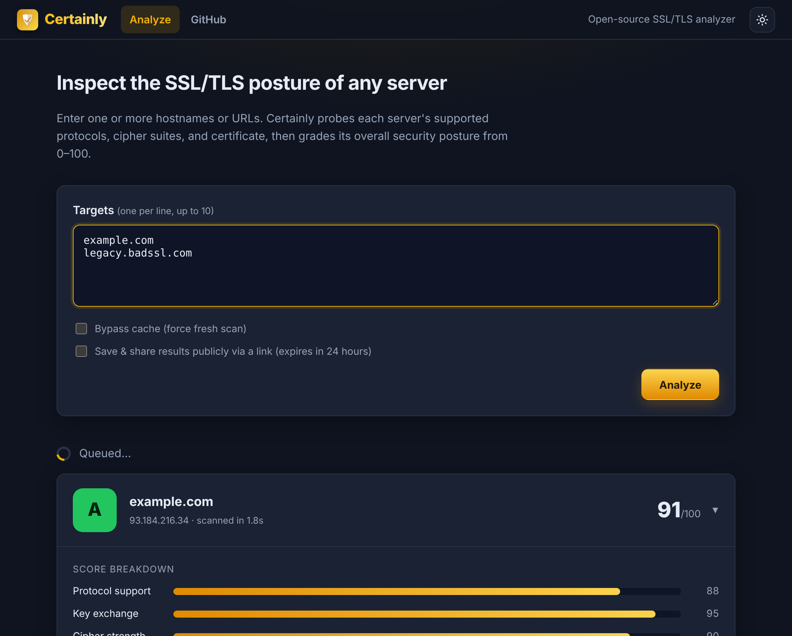
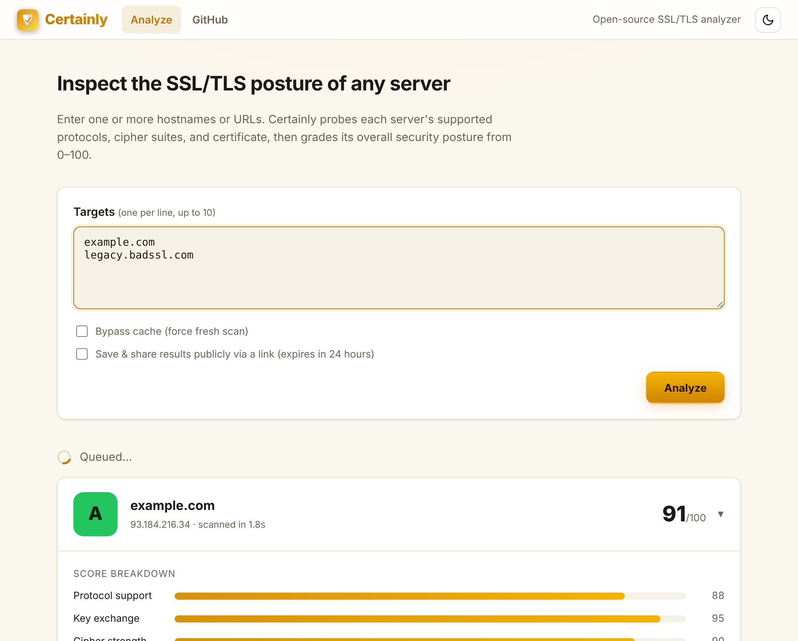

<p align="center">
  
</p>

<h1 align="center">Certainly</h1>

<p align="center">
  <strong>Know exactly how any server's SSL/TLS stacks up.</strong><br>
  A free, open-source, self-hostable alternative to Qualys SSL Labs.
</p>

<p align="center">
  <a href="https://github.com/zollo/certainly/actions/workflows/release.yml"></a>
  <a href="https://github.com/zollo/certainly/releases"></a>
  <a href="LICENSE"></a>
</p>

---

Point Certainly at one or more servers and it inspects their certificates,
supported protocols and cipher suites, then scores each one from **0–100** with
a convenience letter grade (A+ … F). Everything the web UI shows is also
available over a simple REST API, so you can wire scans into scripts and CI. Run
it yourself with `docker compose up`, or see a live instance at
**[certainly.zollo.net](https://certainly.zollo.net)**.

<p align="center">
  
</p>

## Features

**Analyze any server**
- A clean, mobile-friendly web UI — scan up to *N* targets at once (default 10,
  configurable).
- Accepts hostnames or URLs (`example.com`, `host:8443`, `https://…`).
- Hosts are scanned concurrently, and each host's protocol and cipher probes run
  in parallel, so a batch finishes fast.

**Scored and graded**
- A weighted **0–100** score across protocol support, key exchange, cipher
  strength and certificate, following a methodology inspired by the SSL Labs
  rating guide.
- Materially weak conditions (obsolete protocols, broken ciphers, missing
  forward secrecy, certificate problems) cap the score; a convenience letter
  grade (A+ … F) sits on top for at-a-glance reading.

**Deep certificate detail**
- Serial number, revocation endpoints (OCSP/CRL) and a **validated live OCSP
  status**, OCSP Must-Staple, Certificate Transparency (SCTs), and DNS CAA.
- Per-host findings, including a post-quantum-cryptography (PQC) readiness check.

**REST API**
- Everything the UI does goes through an unauthenticated API: submit a scan, get
  a **job ID**, poll for status, retrieve results. Interactive docs at `/docs`.

**Cache and share**
- Results are cached in Redis (default 24h, configurable).
- Optionally save a scan and share it via a public link that expires
  automatically (off by default).

**Light and dark**
- A polished interface in both light and dark themes, with your choice
  remembered. A build-info footer shows exactly which version, commit and build
  is running.

**Container-native**
- `docker compose up` and you're running. Every setting is an environment
  variable or a line in `.env`. Pre-built, signed, multi-arch images ship to
  GHCR on every release.

<p align="center">
  
</p>

## Self-hosting

Certainly is a FastAPI app (web UI + REST API), one or more RQ workers that run
the scans, and Redis for the job queue and result cache. Images are published to
GHCR as `ghcr.io/zollo/certainly` for every release.

### Docker Compose

```bash
git clone https://github.com/zollo/certainly.git
cd certainly
docker compose up --build
```

Then open <http://localhost:8000>. To customize configuration, copy
`.env.example` to `.env` and edit it, or set `CERTAINLY_*` environment variables
directly. Scale scanning throughput by adding workers:

```bash
docker compose up --scale worker=3
```

**Use the pre-built image** instead of building from source — every push to
`main` publishes a multi-arch image (linux/amd64 + arm64) to GHCR:

```bash
docker pull ghcr.io/zollo/certainly:latest
```

Each published image is tagged `latest`, the exact version `X.Y.Z`, the `X.Y`
line, and a short commit SHA. Pin `X.Y.Z` for reproducible deploys, `X.Y` to
float within a minor line, or `latest` for the newest. Images are cosign-signed
and carry a build-provenance attestation.

**For production**, use `docker-compose.prod.yml`, which pulls the pre-built
image, enables Redis persistence (so cached results and job records survive
restarts) and adds container health checks:

```bash
# Run the latest published image
docker compose -f docker-compose.prod.yml up -d

# Pin a specific version
CERTAINLY_VERSION=1.0.0 docker compose -f docker-compose.prod.yml up -d

# Scale scanning throughput with more workers
docker compose -f docker-compose.prod.yml up -d --scale worker=3
```

### Local (no Docker)

Certainly needs Redis for the job queue and cache. For quick local development
you can skip both the worker and Redis by enabling the **inline worker**, which
runs scans synchronously inside the API process:

```bash
python -m venv .venv && source .venv/bin/activate
pip install -r requirements.txt
pip install -e .

# Inline mode: no Redis or worker required.
CERTAINLY_USE_INLINE_WORKER=true uvicorn certainly.main:app --reload
```

For the full setup (recommended), run Redis and a worker:

```bash
redis-server                      # terminal 1
python -m certainly.worker        # terminal 2 — worker
uvicorn certainly.main:app --reload   # terminal 3 — API + UI
```

### TrueNAS SCALE

To run Certainly as a **Custom App** on TrueNAS SCALE (Electric Eel 24.10+), see
[`deploy/truenas/`](deploy/truenas/) — a ready-to-paste Compose file with
step-by-step install instructions.

### Kubernetes (Helm)

A Helm chart is published to GHCR with each release, versioned like the app:

```bash
helm install certainly oci://ghcr.io/zollo/charts/certainly --version 1.7.0 \
  --set ingress.enabled=true \
  --set ingress.hosts[0].host=certainly.example.com
```

The chart deploys the API, a worker, and a bundled Redis (use an external Redis
by setting `redis.enabled=false`). See
[`charts/certainly/README.md`](charts/certainly/README.md) for every value.

### GitOps (Argo CD)

The live instance at [certainly.zollo.net](https://certainly.zollo.net) is
deployed by Argo CD from [`zollo/homelab-k8s`](https://github.com/zollo/homelab-k8s)
under `gitops/apps/certainly/` — a `dev` environment tracking the newest chart
release and a `prod` environment pinned to a chart version. Promote a release to
prod by bumping `targetRevision` once it has been checked on dev.

## API

The web UI is built entirely on top of this API. No authentication is required.
See the interactive docs at **`/docs`** for the complete schema.

### `POST /api/scan`

Queue a scan. Returns a job ID immediately.

```bash
curl -s -X POST http://localhost:8000/api/scan \
  -H 'Content-Type: application/json' \
  -d '{"targets": ["example.com", "https://github.com", "badssl.com"]}'
```

```json
{
  "job_id": "a1b2c3…",
  "status": "queued",
  "targets": ["example.com", "https://github.com", "badssl.com"],
  "status_url": "http://localhost:8000/api/jobs/a1b2c3…/status",
  "result_url": "http://localhost:8000/api/jobs/a1b2c3…"
}
```

Request body:

| Field          | Type       | Default | Description                                    |
| -------------- | ---------- | ------- | ---------------------------------------------- |
| `targets`      | `string[]` | —       | Hostnames or URLs (`example.com`, `host:8443`, `https://…`). |
| `bypass_cache` | `boolean`  | `false` | Force a fresh scan, ignoring cached results.   |
| `share`        | `boolean`  | `false` | Save the result and expose it at a public share URL (expires after the configured TTL). |

When `share` is `true` (and sharing is enabled), the response also includes a
`share_id` and a `share_url` (e.g. `http://localhost:8000/s/<id>`) that anyone
can open until it expires.

### Other endpoints

| Endpoint | Description |
| --- | --- |
| `GET /api/jobs/{job_id}/status` | Lightweight status for polling (`queued`, `running`, `finished`, `failed`). |
| `GET /api/jobs/{job_id}` | The full job record; when `finished`, `results` has one entry per target with score, grade, certificate details, protocols, ciphers and findings. |
| `GET /api/shares/{share_id}` | The publicly shared result for a scan submitted with `share: true`, plus `share_expires_at`. `404` once it expires. |
| `GET /api/config` | UI-relevant limits and flags (`max_targets_per_request`, `cache_ttl_seconds`, `default_port`, `enable_sharing`, `share_ttl_seconds`). |
| `GET /api/health` | Liveness probe. |

## Scoring

Each host gets a **0–100** score composed of four weighted components,
following a methodology inspired by the [SSL Labs rating guide][ssllabs]:

| Component          | Weight | Basis                                             |
| ------------------ | ------ | ------------------------------------------------- |
| Protocol support   | 30%    | Best/worst negotiated TLS version                 |
| Key exchange       | 30%    | Certificate key strength + forward secrecy        |
| Cipher strength    | 40%    | Strongest/weakest offered cipher                  |
| Certificate        | gate   | Validity, trust, hostname match, signature        |

A series of **caps** then lower the score for materially weakening conditions —
obsolete protocols (SSLv3, TLS 1.0/1.1), weak or broken ciphers (RC4, 3DES,
NULL, EXPORT), missing forward secrecy, or certificate problems. Certificate
issues (expired, self-signed, hostname mismatch) are a hard gate that force a
failing grade. HSTS is required to reach the top grade (A+).

The numeric score maps to a letter grade for at-a-glance reading:

`A+` ≥ 95 · `A` ≥ 80 · `B` ≥ 65 · `C` ≥ 50 · `D` ≥ 35 · `E` ≥ 20 · `F` < 20

[ssllabs]: https://github.com/ssllabs/research/wiki/SSL-Server-Rating-Guide

## Configuration

All settings are read from the environment (prefix `CERTAINLY_`) or a `.env`
file. See [`.env.example`](.env.example) for the full list. The most common:

| Variable                             | Default                    | Description                                  |
| ------------------------------------ | -------------------------- | -------------------------------------------- |
| `CERTAINLY_MAX_TARGETS_PER_REQUEST`  | `10`                       | Max targets per scan request.                |
| `CERTAINLY_CACHE_TTL_SECONDS`        | `86400` (24h)              | How long results are cached (0 disables).    |
| `CERTAINLY_ENABLE_SHARING`           | `true`                     | Allow saving/sharing results via public URL. |
| `CERTAINLY_SHARE_TTL_SECONDS`        | `86400` (24h)              | How long a shared result stays available.    |
| `CERTAINLY_SCAN_CONCURRENCY`         | `10`                       | Hosts scanned in parallel per job.           |
| `CERTAINLY_PROBE_CONCURRENCY`        | `12`                       | Parallel probes per host.                    |
| `CERTAINLY_CONNECT_TIMEOUT`          | `8`                        | Socket timeout (seconds).                    |
| `CERTAINLY_CHECK_CAA`                | `true`                     | DNS CAA lookup (via DNS-over-HTTPS) per host.|
| `CERTAINLY_CHECK_REVOCATION`         | `true`                     | Validated live OCSP revocation status per host.|
| `CERTAINLY_CAA_DOH_URL`              | `https://dns.google/resolve` | DoH JSON resolver used for CAA lookups.    |
| `CERTAINLY_REDIS_URL`                | `redis://localhost:6379/0` | Redis for queue + cache.                     |
| `CERTAINLY_USE_INLINE_WORKER`        | `false`                    | Run jobs in-process (dev only).              |

## Architecture

```
          ┌──────────────┐   POST /api/scan    ┌──────────────┐
 Browser  │   Web UI     │ ──────────────────▶ │  FastAPI     │
 / client │ (static JS)  │ ◀────────────────── │  API         │
          └──────────────┘   job_id + polling  └──────┬───────┘
                                                       │ enqueue
                                                       ▼
                                                 ┌───────────┐
                                                 │   Redis   │  queue + cache
                                                 └─────┬─────┘
                                                       │ dequeue
                                                       ▼
                                                 ┌───────────┐  parallel per-host
                                                 │  Worker   │  + per-probe scans
                                                 └───────────┘
```

- **`certainly/scanner/`** — the analysis engine: protocol probing (`tls.py`),
  certificate parsing (`certificate.py`), HSTS checks (`http_checks.py`), and
  scoring (`scoring.py`), orchestrated by `analyzer.py`.
- **`certainly/jobs.py`** — job lifecycle, queueing, and caching.
- **`certainly/main.py`** — FastAPI app (API + static UI).
- **`certainly/worker.py`** — RQ worker entrypoint.

## Development

```bash
pip install -e ".[dev]"
pytest
```

The test suite runs fully offline (scoring, target parsing, cipher
classification, and the API in inline mode) — no network access required.

**Contribute via PRs with Conventional Commit titles.** A `PR Title` check
enforces the format (`feat: add X`, `fix: correct Y`, `docs: …`, `ci: …`). The
repo squash-merges with the **PR title as the commit subject**, so the title
drives the release version.

**On every merge to `main`**, CI (`.github/workflows/release.yml`) computes the
next version from the commits since the last tag — `feat:` → minor, `fix:` →
patch, `BREAKING CHANGE:` (or `type!:`) → major, otherwise patch — then tags it,
publishes a **GitHub Release** with auto-generated notes, and builds and pushes
the signed image and Helm chart. Certainly follows
[Semantic Versioning](https://semver.org/) driven by
[Conventional Commits](https://www.conventionalcommits.org/); the first release
was seeded at `v1.0.0`.

## License

[MIT](LICENSE). Scores are informational and provided without warranty.

**Stack:** FastAPI · RQ · Redis · vanilla JS + CSS · Docker Compose · Helm ·
Argo CD
